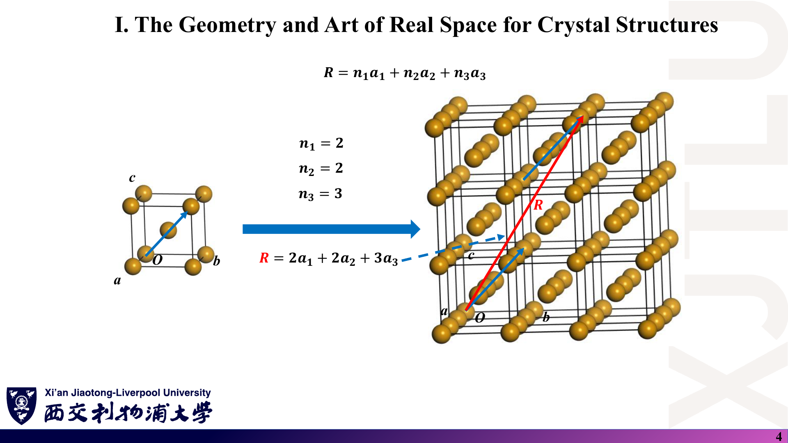
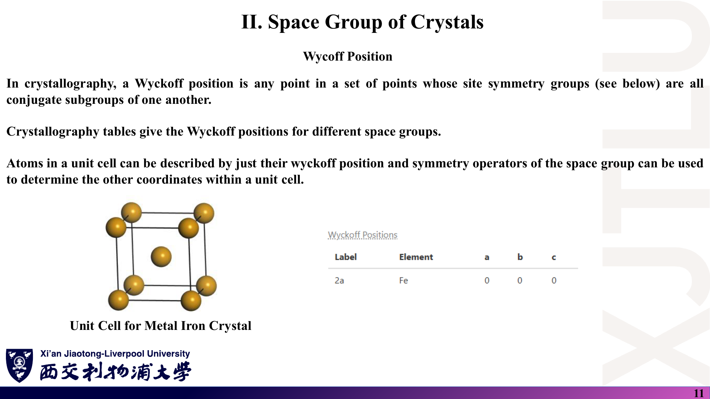
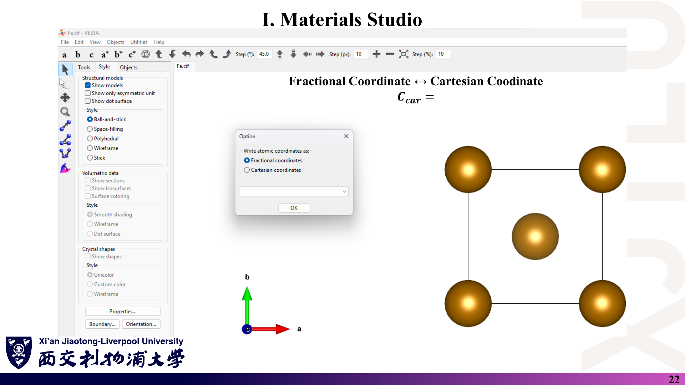

# 07 · 图文勘误、符号约定与易错点

[返回目录](README.md)

> 本文是**学习核对记录，不是教师发布的官方勘误**。截图忠实保留原稿；每条依次给出“原图证据（课件截图）→ 问题（中文解释）→ 正确写法与核验理由（原理深入）”。区分明确的笔误、没有说清的约定，以及不应泛化的物理结论。页码均为包含封面的 PDF 物理页码。

## 1. 惯用胞的边、Wyckoff 拼写

### 课件截图

### 中文解释

**问题**：

1. 第 4 页用 BCC 铁的立方胞边 a、b、c 演示 $\mathbf R=n_1\mathbf a_1+n_2\mathbf a_2+n_3\mathbf a_3$，容易让人以为立方边就是 BCC 的原胞矢量。〔易错点，非笔误〕
2. 第 11 页标题 “Wycoff Position” 应为 **Wyckoff**；定义句中 “site symmetry groups (see below)” 在本页没有下文（来自外部文本的摘录）。〔笔误〕

### 原理深入

**正确写法**：若 $\mathbf a_i$ 取立方边，整数组合只能得到简单立方格点，体心 $(\tfrac12,\tfrac12,\tfrac12)$ 必须作为基元的第二个原子；若要用一组 $\mathbf a_i$ 生成全部 BCC 格点，应取原胞矢量 $\tfrac a2(-1,1,1)$、$\tfrac a2(1,-1,1)$、$\tfrac a2(1,1,-1)$。

**核验理由**：体心位置 $\tfrac a2(1,1,1)$ 的立方坐标是半整数，不可能等于 $n_1a\hat{\mathbf x}+n_2a\hat{\mathbf y}+n_3a\hat{\mathbf z}$（$n_i\in\mathbb Z$）；而用原胞矢量时 $\tfrac a2(1,1,1)=\mathbf a_1+\mathbf a_2+\mathbf a_3$。

“位置对称群”（site-symmetry group）指保持某点不动的空间群元素集合，见 [01 第 4 节](01_晶体几何与空间群.md)。

### Ref

- **原课件**：[Lecture Five，PDF 第 4 页](../Lecture_Five.pdf#page=4)、[第 11 页](../Lecture_Five.pdf#page=11)。
- **规范写法**：[01 第 1、4 节](01_晶体几何与空间群.md)；延伸 [SS1](README.md#ref-ss1)、[ITA](README.md#ref-ita)。

## 2. 倒格矢：“b = 1/a” 与二维 b₂ 公式

### 课件截图

### 中文解释

**问题**：

1. 第 5 页写 $\mathbf b_1=2\pi\frac{\mathbf a_2\times\mathbf a_3}{V}=\frac1{\mathbf a_1}$ 等。矢量的倒数没有定义，等式右边还丢了 $2\pi$。〔记号不严谨〕
2. 第 7 页二维特例中 $\mathbf b_2=2\pi\frac{\mathbf a_2\times\hat{\mathbf n}}{A}$，与 $\mathbf b_1$ 完全相同。〔公式错误〕

### 原理深入

**正确写法**：

$$
\mathbf a_i\cdot\mathbf b_j=2\pi\delta_{ij};\qquad
\text{仅当晶格正交时}\ |\mathbf b_i|=\frac{2\pi}{|\mathbf a_i|}.
$$

$$
\boxed{\mathbf b_2=2\pi\,\frac{\hat{\mathbf n}\times\mathbf a_1}{A}},\qquad A=\mathbf a_1\cdot(\mathbf a_2\times\hat{\mathbf n}).
$$

**核验理由**：

- 反例（六角格子）：$|\mathbf a_1|=a$，但 $|\mathbf b_1|=\tfrac{4\pi}{\sqrt3a}\ne\tfrac{2\pi}{a}$，所以“$b=1/a$”（即使补上 $2\pi$）对斜交晶格不成立。
- 第 7 页原式给出 $\mathbf a_2\cdot\mathbf b_2=0$，违反对偶关系；改为 $\hat{\mathbf n}\times\mathbf a_1$ 后 $\mathbf a_1\cdot\mathbf b_2=0$、$\mathbf a_2\cdot\mathbf b_2=2\pi$。这也正是三维公式 $\mathbf b_2\propto\mathbf a_3\times\mathbf a_1$ 取 $\mathbf a_3=\hat{\mathbf n}$ 的结果。
- 第 5 页分量展开中的“×”表示数乘，与矢量叉积同一符号，阅读时注意区分。

### Ref

- **原课件**：[Lecture Six，PDF 第 5 页](../Lecture_Six.pdf#page=5)、[第 7 页](../Lecture_Six.pdf#page=7)。
- **规范写法**：[02 第 2、4 节](02_倒空间与布里渊区.md)；[复习题第 7 题](06_复习题与参考答案.md)。

## 3. p 型半导体的费米能级位置

### 课件截图

### 中文解释

**问题**：“p-type Semiconductor: … $E_f$ is close to minimum of Valence Band” 应为价带**顶**（maximum）。〔笔误〕

### 原理深入

**正确写法**：p 型——空穴为多数载流子，$E_F$ 靠近**价带顶（VBM）**；n 型——$E_F$ 靠近**导带底（CBM）**。

**核验理由**：空穴是价带顶附近的空态；受主掺杂使电子缺失，化学势下移到价带顶附近。价带“底”在能量轴的远端，与载流子无关。讲义右图本身也显示 $E_F=0$ 贴在价带顶。

### Ref

- **原课件**：[Lecture Seven，PDF 第 14 页](../Lecture_Seven.pdf#page=14)。
- **规范写法**：[03 第 6 节](03_晶体对称性与能带.md)；[复习题第 15 题](06_复习题与参考答案.md)；延伸 [SS2](README.md#ref-ss2)。

## 4. Ga₂O₃ 的轨道数与能带数

### 课件截图

### 中文解释

**问题**：

1. “Ga: 2×1+2×3+2×5 = 19” 应为 **18**。〔算术错误〕
2. “Total Number of Band: 1216+1248 = 2426” 加法本身也错（应为 2464）；用正确的 18 计算，总数为 **2400**。〔算术错误〕
3. 左侧示例构型 $1s^22s^22p^63s^23p^3$ 是磷（P），与右侧 Ga₂O₃ 无关，只作记号说明。〔易混点〕

### 原理深入

**正确写法**：

$$
\text{Ga}:\ 2+6+10=18,\quad \text{O}:\ 2+6+5=13,\quad
18\times64+13\times96=1152+1248=2400 .
$$

**核验理由**：逐项相乘再相加即可；$2\times5=10$，$2+6+10=18$。若开启非共线自旋/SOC，能带数为 4800。“Band for Ga”宜称“来自 Ga 的基函数数”，能带本身是所有轨道杂化后的本征态，不属于某一种原子。

### Ref

- **原课件**：[Lecture Seven，PDF 第 19 页](../Lecture_Seven.pdf#page=19)。
- **规范写法**：[03 第 9 节](03_晶体对称性与能带.md)；[复习题第 12 题](06_复习题与参考答案.md)；延伸 [OMX](README.md#ref-omx)。

## 5. POSCAR 标注：晶格矢量与分数坐标

### 课件截图

### 中文解释

**问题**：

1. 第 3–5 行被标为 “Lattice Constant along three axes”，实际是三条**晶格矢量**的笛卡尔分量（每行一条）。〔表述不严谨〕
2. `Direct` 下各列被标为 “Atom coordinate along x / y / z axis”，实际是沿 $\mathbf a_1,\mathbf a_2,\mathbf a_3$ 的**分数坐标**。〔表述错误，对非正交胞会导致读错〕
3. 第 1 行标为 “File name”，在 VASP 中它是任意注释行。〔约定说明〕

### 原理深入

**正确写法**：$\mathbf r_{\rm car}=f_1\mathbf a_1+f_2\mathbf a_2+f_3\mathbf a_3$，其中 $(f_1,f_2,f_3)$ 是 `Direct` 下一行的三个数。

**核验理由**：立方 Fe 中 $\mathbf a_i$ 恰好沿坐标轴且等长，分数坐标与笛卡尔坐标只差一个因子 $a$，所以讲义标注“看起来对”。换成石墨烯（$\mathbf a_2=a(\tfrac12,\tfrac{\sqrt3}2,0)$），分数坐标 $(\tfrac13,\tfrac13,0)$ 对应笛卡尔 $a(\tfrac12,\tfrac{\sqrt3}6,0)$，两者显然不同。官方定义见 [POSCAR](README.md#ref-poscar)。

### Ref

- **原课件**：[Lecture Eight，PDF 第 23 页](../Lecture_Eight.pdf#page=23)。
- **规范写法**：[04 第 2–3 节](04_结构建模_HPC与倒格矢编程.md)。

## 6. 不可约布里渊区能“涵盖”哪些信息？

### 课件截图

### 中文解释

**问题**：讲义说 IBZ “usually covers all important information … such as band gap, berry curvature, spin feature”。这句话对标量能量基本成立，对矢量/赝矢量性质需要限定；而且“沿 IBZ 边界画能带”与“在 IBZ 内采样”不是一回事。〔需要限定的结论〕

### 原理深入

**正确理解**：

1. $E_n(\hat S\mathbf k)=E_n(\mathbf k)$ 保证能量可由 IBZ 复制；**但带隙的极值可能在 IBZ 内部**，只沿高对称路径画能带可能漏掉真实的 CBM/VBM。
2. Berry 曲率、自旋期望值等在对称操作下按各自的变换规则改变（例如时间反演下 $\Omega_n(-\mathbf k)=-\Omega_n(\mathbf k)$，镜面会翻转某些分量），不能直接把 IBZ 中的值“平铺”到全区。
3. 在 IBZ 中做积分必须带上 k 点权重；含磁序时应使用磁对称性（对称操作通常减少，IBZ 变大）。

**核验理由**：若把时间反演联系的 $\pm\mathbf k$ 都按“相等”处理，非磁体系的总 Berry 曲率积分会被错误地加倍而非抵消——与“T 对称体系反常霍尔电导为零”的已知结论矛盾。

### Ref

- **原课件**：[Lecture Six，PDF 第 21 页](../Lecture_Six.pdf#page=21)。
- **规范写法**：[02 第 9 节](02_倒空间与布里渊区.md)；延伸 [GT](README.md#ref-gt)。

## 7. 对称操作的矩阵记号与“平移操作”

### 课件截图

### 中文解释

**问题**：

1. 第 4–6 页的矩阵都用单竖线 $|\cdot|$ 包围，这是行列式记号。〔记号错误〕
2. “x mirror” 未说明是哪一个平面：矩阵 $\operatorname{diag}(-1,1,1)$ 表示把 $x$ 变号，即关于 $yz$ 平面的反射。〔约定未说明〕
3. 第 6 页说空间群 = 点群操作 + “translational operations (like glide planes and screw axes)”。滑移面、螺旋轴是**点操作与分数平移的组合**，不是纯平移。〔表述不严谨〕

### 原理深入

**正确写法**：用圆括号或方括号书写矩阵，例如 $\sigma_x=\begin{pmatrix}-1&0&0\0&1&0\0&0&1\end{pmatrix}$；其**行列式**才是 $|\sigma_x|=-1$。空间群元素统一写成 Seitz 记号 $\{R|\mathbf t\}$，纯平移为 $\{E|\mathbf R\}$，滑移面为 $\{\sigma|\mathbf t\}$、螺旋轴为 $\{C_n|\mathbf t\}$，其中 $\mathbf t$ 为分数格矢。

**核验理由**：$|R_z(\theta)|=\cos^2\theta+\sin^2\theta=1$ 是标量，不能作用于坐标；把滑移面看作纯平移会导致“去掉平移部分后得到点群”这一步出错。

### Ref

- **原课件**：[Lecture Seven，PDF 第 4–6 页](../Lecture_Seven.pdf#page=4)。
- **规范写法**：[03 第 1 节](03_晶体对称性与能带.md)、[01 第 3 节](01_晶体几何与空间群.md)；延伸 [ITA](README.md#ref-ita)。

## 8. Kramers 定理的表述与 Mn₃Sn 的例子

### 课件截图

### 中文解释

**问题**：

1. 名称应为 **Kramers**（Hendrik Kramers）定理，不是 “Kramer’s”。〔拼写〕
2. “every energy state is at least two-fold degenerate $E_n(\mathbf k,\uparrow)=E_n(-\mathbf k,\downarrow)$”：等式联系的是两个**不同的** k 点；同一 k 点的 Kramers 简并只在时间反演不变动量处保证。〔需要限定〕
3. 第 10 页把 Kagome 化合物 **Mn₃Sn** 列为“缺乏反演对称”的例子。Mn₃Sn 的晶体结构一般报道为六方 $P6_3/mmc$（中心对称）；其非常规自旋/输运性质主要来自非共线反铁磁序对时间反演的破坏。〔需要核对的举例〕

### 原理深入

**正确写法**：

- 时间反演对称（无磁）：$E_n(\mathbf k,\sigma)=E_n(-\mathbf k,-\sigma)$；在 $\mathbf k\equiv-\mathbf k$（Γ、M 等）处 Kramers 对位于同一点。
- 加上反演：每个 k 点二重简并。
- 打破简并的途径应区分：**晶格层面**破坏反演（Janus 层、极性表面/界面）与**磁层面**破坏时间反演（铁磁、非共线反铁磁如 Mn₃Sn）。

**核验理由**：Kramers 定理的证明依赖 $T^2=-1$ 使 $|\psi\rangle$ 与 $T|\psi\rangle$ 正交；$T$ 把 Bloch 态 $\mathbf k$ 映到 $-\mathbf k$，所以一般 k 点的伙伴在 $-\mathbf k$。Mn₃Sn 的空间群可在其晶体学数据库条目（如 Materials Project / ICSD）中核对；本笔记未独立复现该材料的计算，此条作为“建议核对”列出。

### Ref

- **原课件**：[Lecture Seven，PDF 第 9–10 页](../Lecture_Seven.pdf#page=9)。
- **规范写法**：[03 第 4 节](03_晶体对称性与能带.md)；[复习题第 10 题](06_复习题与参考答案.md)；延伸 [GT](README.md#ref-gt)。

## 9. 带隙分类、费米能级与“满带/平带”的易混点

### 课件截图

### 中文解释

这一节不是笔误，而是课堂简化说法与严格定义之间的差距：

1. $E_F$ 被定义为“全满带与全空带的分界”；严格说它是化学势，在半导体中位于带隙内的某一具体能量。
2. 本征石墨烯 “Conductor: Gap = 0”：更准确是**半金属 / 零带隙半导体**，费米能处态密度为零。
3. 5 eV 的半导体/绝缘体分界是约定；DFT 带隙通常偏小（SiO₂ 的 5.4 eV 为计算值，实验约 9 eV 量级）。
4. 第 17 页把“满的孤立带中电子不能移到其他带”与“迁移率为零”并列，实际是两个机制：满带总电流为零（与色散无关），平带群速度为零、有效质量无穷大。

### 原理深入

**严格表述**：

$$
f(E)=\frac{1}{e^{(E-\mu)/k_BT}+1},\quad f(\mu)=\tfrac12;\qquad
\mathbf j_{\rm 满带}=-\frac{e}{V}\sum_{\mathbf k\in\rm BZ}\mathbf v(\mathbf k)=0;\qquad
\mu_{\rm mob}=\frac{e\tau}{m^*}.
$$

**核验理由**：$\mathbf v(\mathbf k)=\hbar^{-1}\nabla_{\mathbf k}E$ 在整个布里渊区上的积分是周期函数梯度的积分，恒为零——所以满带不导电与能带形状无关；而平带的 $\mathbf v\equiv0$ 是另一回事。石墨烯 DOS 在 $E_F$ 处线性趋于零，与金属的有限 DOS 不同。

### Ref

- **原课件**：[Lecture Seven，PDF 第 13、15–17 页](../Lecture_Seven.pdf#page=13)。
- **规范写法**：[03 第 6–7 节](03_晶体对称性与能带.md)；延伸 [SS1](README.md#ref-ss1)、[GR09](README.md#ref-gr09)。

## 10. 原 PDF 中的缺字与排版小问题

### 课件截图

### 中文解释

以下两处内容在**原 PDF 文件中即已缺失**，截图忠实保留了缺失状态，本笔记**没有在图上修补**：

1. **Lecture Seven 第 21 页**：“3N×3N supercell gives the Dirac point folded onto ␣ point in first BZ”——缺少的符号按上下文和右侧能带图（交点位于 Γ）应为 **Γ**。PDF 文本层同样只有 “onto point”。
2. **Lecture Eight 第 22 页**：“Fractional Coordinate ↔ Cartesian Coodinate，$C_{car}=$” 之后为空白，PDF 文本层也只有一个 “=”。缺失内容无法从文件中恢复；按标题推断应为分数坐标到笛卡尔坐标的换算式，本笔记在 [04 第 2 节](04_结构建模_HPC与倒格矢编程.md) 给出了标准形式 $\mathbf r_{\rm car}=f_1\mathbf a_1+f_2\mathbf a_2+f_3\mathbf a_3$（补充，非原式）。

其他排版小问题：Lecture Eight 第 22 页 “Coodinate” 应为 Coordinate；Lecture Five 第 12 页右下角页码折成两行；Lecture Six 第 3 页 “One see atoms” 应为 “One sees”。

### 原理深入

**为什么判断是原文件缺失，而不是截图渲染问题**：

- 两处的 PDF 文本层都没有对应字符：第 21 页文本只有 “Dirac point folded onto ”，第 22 页公式区只有 “=”；
- 分别用 pdftoppm（poppler）与 PyMuPDF（MuPDF）两种渲染器重新渲染，结果相同；
- 同一讲义其他页的 Γ（如 Lecture Seven 第 8 页 “like Γ or K”）正常显示，说明不是全局字体问题；更可能是导出 PDF 时个别符号或公式对象未被写入。

若需要确认原意，建议对照教师原始 PPT 或课堂录像。

### Ref

- **原课件**：[Lecture Seven，PDF 第 21 页](../Lecture_Seven.pdf#page=21)、[Lecture Eight，PDF 第 22 页](../Lecture_Eight.pdf#page=22)。
- **规范写法**：[03 第 10 节](03_晶体对称性与能带.md)、[04 第 2 节](04_结构建模_HPC与倒格矢编程.md)；截图生成方式见 [来源索引](课件截图/来源索引.json)。

## 核对优先级

1. **对偶关系**：任何倒格矢公式先验 $\mathbf a_i\cdot\mathbf b_j=2\pi\delta_{ij}$。
2. **算术与计数**：轨道数、格点数、能带数逐项重算。
3. **坐标系**：分清分数坐标/笛卡尔坐标、惯用胞/原胞、含不含 $2\pi$。
4. **对称性层级**：区分晶格对称与磁对称、同一 k 点的简并与不同 k 点的等价。
5. **方法与约定**：DFT 带隙、5 eV 分界、$E_F=0$ 的作图约定都不是物理定律。
