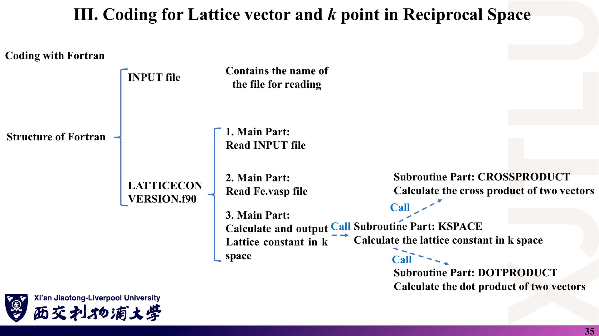
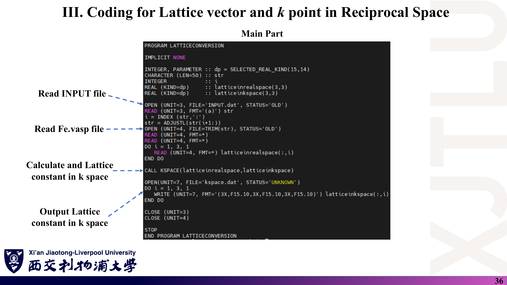
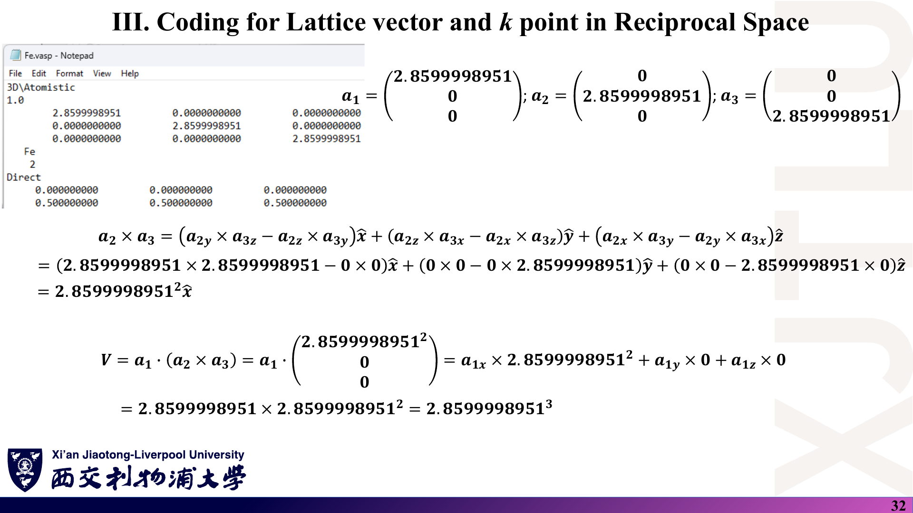
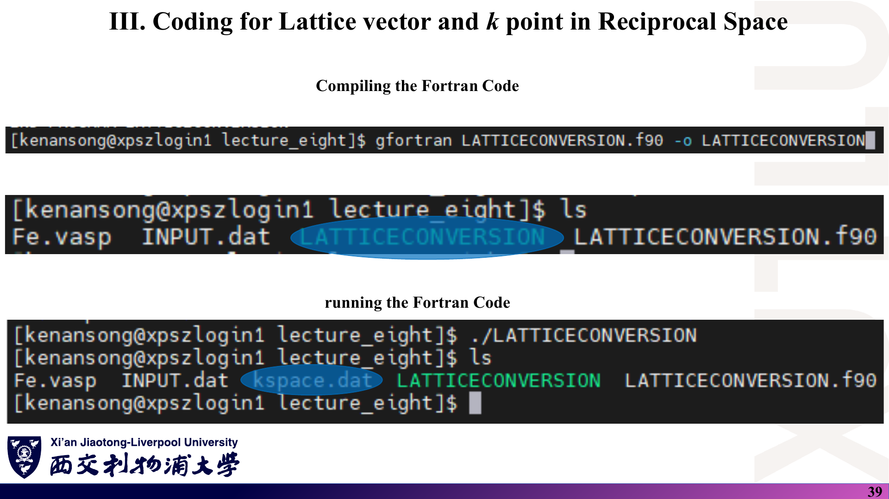

# 08 · 代码导读：LATTICECONVERSION.f90

来源：[`Codes/`](../Codes/) 目录（教师提供，未修改）；对应 [Lecture_Eight.pdf](../Lecture_Eight.pdf) 第 31–40 页。

[返回目录](README.md)

> 本文逐段解释教师示例程序并报告本笔记作者的核验。行号指 `LATTICECONVERSION.f90` 的源码行。标注〔核验〕的结论来自阅读源码以及在本地用 gfortran 实际编译运行（输入文件复制到临时目录，未改动 `Codes/`）；它们不是教师的说明。

## 1. Codes 目录里有哪些文件？

### 课件截图



### 中文解释

| 文件 | 作用 |
|---|---|
| `LATTICECONVERSION.f90` | 主程序（86 行）：读结构文件中的晶格矢量，计算倒格矢 |
| `INPUT.dat` | 一行 `File Name: Fe.vasp`，指定要读的结构文件 |
| `Fe.vasp` | 立方 BCC Fe 的 POSCAR（VESTA 导出，$a=2.8599998951$ Å，2 个原子） |
| `kspace.dat` | 程序输出：三行，每行一条倒格矢的 $x,y,z$ 分量（Å⁻¹） |

本周 `Codes/` 中**没有** `compile.sh`/`run.sh`；讲义第 39 页直接在登录节点用命令行编译运行。

### 原理深入

程序结构：外部子程序 `DOTPRODUCT`（第 1–11 行）、`CROSSPRODUCT`（第 13–25 行）、`KSPACE`（第 27–52 行），主程序 `LATTICECONVERSION`（第 54–86 行）。调用关系：

```text
LATTICECONVERSION ──► KSPACE ──► CROSSPRODUCT（3 次）
                                 └► DOTPRODUCT（1 次，求体积）
```

三个子程序是“外部过程”（不在 module 内，也没有 interface 块），编译器不会检查实参与形参的类型/形状是否匹配——在这个小程序里没有问题，但写大程序时建议放进 `MODULE`。

### Ref

- **原课件**：[Lecture Eight，PDF 第 34–35 页](../Lecture_Eight.pdf#page=34)。
- **源码**：[`LATTICECONVERSION.f90`](../Codes/LATTICECONVERSION.f90) · [`INPUT.dat`](../Codes/INPUT.dat) · [`Fe.vasp`](../Codes/Fe.vasp) · [`kspace.dat`](../Codes/kspace.dat)。

## 2. 主程序怎样读取输入？（第 54–73 行）

### 课件截图



### 中文解释

```fortran
INTEGER, PARAMETER :: dp = SELECTED_REAL_KIND(15,14)   ! 双精度：≥15 位有效数字
CHARACTER (LEN=50) :: str
REAL (KIND=dp)     :: latticeinrealspace(3,3)          ! 第 i 列 = a_i

OPEN (UNIT=3, FILE='INPUT.dat', STATUS='OLD')
READ (UNIT=3, FMT='(a)') str          ! 读整行 "File Name: Fe.vasp"
i = INDEX (str,':')                   ! 冒号的位置
str = ADJUSTL(str(i+1:))              ! 取冒号后的部分并去掉前导空格 -> "Fe.vasp"
OPEN (UNIT=4, FILE=TRIM(str), STATUS='OLD')
READ (UNIT=4, FMT=*)                  ! 跳过第 1 行（注释 3D\Atomistic）
READ (UNIT=4, FMT=*)                  ! 跳过第 2 行（缩放因子 1.0）
DO i = 1, 3, 1
   READ (UNIT=4, FMT=*) latticeinrealspace(:,i)   ! 第 3–5 行 -> 第 i 列
END DO
```

### 原理深入

- **`SELECTED_REAL_KIND(15,14)`**：要求至少 15 位十进制精度、指数范围 ±14，通常得到 8 字节 `REAL(8)`。所有子程序都重复声明了同样的 `dp`，保证类型一致。
- **`STATUS='OLD'`**：文件必须已存在，否则运行时报错——所以 `INPUT.dat` 与 `Fe.vasp` 必须和可执行文件在**同一工作目录**（或写全路径）。
- **`FMT=*` 的空读**：`READ(UNIT=4, FMT=*)` 不带变量列表时，仅跳过一条记录（一行）。程序因此**完全不读缩放因子**。
- **列存储**：`latticeinrealspace(:,i)` 把 POSCAR 的第 $i$ 行（矢量 $\mathbf a_i$）存成矩阵第 $i$ **列**。Fortran 按列优先存储，取列切片是连续内存，传给子程序很方便。
- **元素、原子数与坐标行（第 6 行以后）不被读取**——这个程序只需要晶格矢量。
- **文件名长度**：`str` 只有 50 个字符；文件名或路径过长会被截断。

### Ref

- **原课件**：[Lecture Eight，PDF 第 34、36 页](../Lecture_Eight.pdf#page=36)。
- **语言细节**：[GFORT](README.md#ref-gfort)；POSCAR 行含义见 [04 第 3 节](04_结构建模_HPC与倒格矢编程.md)。

## 3. KSPACE 怎样算出倒格矢？（第 1–52 行）

### 课件截图


*第 37–38 页为 `CROSSPRODUCT`、`DOTPRODUCT` 的源码截图，与下方代码相同。*

### 中文解释

```fortran
SUBROUTINE DOTPRODUCT(vector1,vector2,volume)
volume = vector1(1)*vector2(1)+vector1(2)*vector2(2)+vector1(3)*vector2(3)

SUBROUTINE CROSSPRODUCT(vector1,vector2,result)
result(1) = vector1(2)*vector2(3)-vector1(3)*vector2(2)
result(2) = vector1(3)*vector2(1)-vector1(1)*vector2(3)
result(3) = vector1(1)*vector2(2)-vector1(2)*vector2(1)

SUBROUTINE KSPACE(latticeinrealspace,latticeinkspace)
pi = DACOS(-1.0d0)                                         ! π = arccos(-1)
CALL CROSSPRODUCT(a(:,2), a(:,3), cross)                   ! a2 × a3
CALL DOTPRODUCT  (a(:,1), cross, volume)                   ! V = a1·(a2×a3)
k(:,1) = cross / volume                                    ! (a2×a3)/V
CALL CROSSPRODUCT(a(:,3), a(:,1), cross);  k(:,2) = cross / volume
CALL CROSSPRODUCT(a(:,1), a(:,2), cross);  k(:,3) = cross / volume
latticeinkspace = latticeinkspace * 2.0d0 * pi             ! 整体乘 2π
```

（为简洁，此处把 `latticeinrealspace`/`latticeinkspace` 缩写为 `a`/`k`。）

### 原理深入

- `CROSSPRODUCT` 正是第 6 讲第 5 页的行列式展开：$(\mathbf u\times\mathbf v)_x=u_yv_z-u_zv_y$，其余轮换。
- `DOTPRODUCT` 的输出变量名叫 `volume`，但它就是普通点积；只有当输入是 $\mathbf a_1$ 与 $\mathbf a_2\times\mathbf a_3$ 时结果才是体积。
- `DACOS(-1.0d0)` 用双精度反余弦得到 π，避免手写常数的精度损失。
- 三条倒格矢都除以**同一个** $V$，与公式中 $V=\mathbf a_1\cdot(\mathbf a_2\times\mathbf a_3)=\mathbf a_2\cdot(\mathbf a_3\times\mathbf a_1)=\cdots$ 的轮换不变性一致。
- **体积符号**：程序没有取绝对值。若晶格矢量为左手系，$V<0$，但 $\mathbf b_i$ 仍满足 $\mathbf a_i\cdot\mathbf b_i=2\pi$（符号在分子分母中抵消），所以结果依然正确——这比讲义第 7 页二维公式中取 $|\cdot|$ 的做法更稳妥。
- **$V=0$**（三条矢量共面）时会除以零，程序不检查；输入错误的 POSCAR 会得到 `Infinity`/`NaN`。

### Ref

- **原课件**：[Lecture Eight，PDF 第 31–33、37–38 页](../Lecture_Eight.pdf#page=31)；公式见 [Lecture Six，PDF 第 4–5 页](../Lecture_Six.pdf#page=4)。
- **理论**：[02 第 2 节](02_倒空间与布里渊区.md)。

## 4. 输出是什么？怎样确认结果正确？（第 75–86 行）

### 课件截图



*第 40 页为 `kspace.dat` 内容的截图。*

### 中文解释

```fortran
CALL KSPACE(latticeinrealspace,latticeinkspace)
OPEN(UNIT=7, FILE='kspace.dat', STATUS='UNKNOWN')       ! 不存在就新建，存在就覆盖
DO i = 1, 3, 1
   WRITE (UNIT=7, FMT='(3X,F15.10,3X,F15.10,3X,F15.10)') latticeinkspace(:,i)
END DO
```

每行输出一条 $\mathbf b_i$（3 个空格 + 宽 15、10 位小数的实数，重复三次）。对 `Fe.vasp`，预期 `kspace.dat` 为：

```text
      2.1969180202      0.0000000000      0.0000000000
      0.0000000000      2.1969180202      0.0000000000
      0.0000000000      0.0000000000      2.1969180202
```

### 原理深入

**手算核对**：$\mathbf b_i=\frac{2\pi}{a}\hat{\mathbf e}_i$，$2\pi/2.8599998951=2.196918020\ldots$ Å⁻¹。

**〔核验〕**本笔记作者在 Windows 上用 gfortran（WinLibs 发行版）把 `LATTICECONVERSION.f90`、`INPUT.dat`、`Fe.vasp` 复制到临时目录编译运行，得到的 `kspace.dat` 与仓库中的文件逐字一致；`-Wall` 只报告一个警告：第 60 行声明的变量 `j` 未使用（无害）。

**其他检查方法**：

1. 把输出与输入代回 $\mathbf a_i\cdot\mathbf b_j=2\pi\delta_{ij}$；
2. 用 SeeK-path 或 VESTA 显示的倒格矢对照（注意它们可能用的是原胞、是否含 $2\pi$）；
3. 换一个已知答案的输入（例如 BCC 原胞，应得 $\tfrac{2\pi}a(0,1,1)$ 等，见 [复习题第 14 题](06_复习题与参考答案.md)）。

**单位与约定**：输出单位是 Å⁻¹，**含 $2\pi$**。部分程序输出的“倒格矢”不含 $2\pi$（晶体学约定），比较前需换算。

### Ref

- **原课件**：[Lecture Eight，PDF 第 32–33、40 页](../Lecture_Eight.pdf#page=32)。
- **数据**：[`kspace.dat`](../Codes/kspace.dat)。

## 5. 怎样在 HPC 上编译和运行？

### 课件截图



### 中文解释

讲义的操作（在登录节点 `xpszlogin1` 上）：

```bash
# 1. 用 MobaXterm 登录 login.hpc.xjtlu.edu.cn，并把 4 个文件上传到同一目录
mkdir -p ~/lecture_eight && cd ~/lecture_eight
ls                                   # Fe.vasp  INPUT.dat  LATTICECONVERSION.f90

# 2. 编译：源文件 -> 可执行文件 LATTICECONVERSION
gfortran LATTICECONVERSION.f90 -o LATTICECONVERSION

# 3. 运行，然后查看结果
./LATTICECONVERSION
ls                                   # 多出 kspace.dat
cat kspace.dat
```

### 原理深入

- **`-o` 指定输出名**；不加时可执行文件默认叫 `a.out`。
- **建议的编译选项〔补充〕**：`gfortran -O2 -Wall -fcheck=all LATTICECONVERSION.f90 -o LATTICECONVERSION`。`-Wall` 报告未使用变量等问题，`-fcheck=all` 在运行时检查数组越界——调试阶段很有用。
- **找不到 gfortran**：许多 HPC 用环境模块管理编译器，需要先 `module avail` 查看、`module load` 对应的 GCC 模块（模块名以学校 HPC 文档为准）。
- **工作目录**：程序用相对路径打开 `INPUT.dat`，必须在文件所在目录执行 `./LATTICECONVERSION`；从别的目录运行会因 `STATUS='OLD'` 报 “Cannot open file”。
- **Windows 换行符**：在 Windows 记事本中编辑后上传的文件可能带 `\r\n`。本程序对数字行用表控读入，通常不受影响；但文件名行末若带 `\r`，`TRIM` 不会去掉它，可能导致 “文件不存在”。遇到时可用 `dos2unix INPUT.dat` 转换。
- **登录节点 vs 计算节点**：这个程序瞬间完成，在登录节点运行可以接受；之后的 DFT 计算应通过作业调度系统提交（后续周的 `compile.sh`/`run.sh` 即为作业脚本）。

### Ref

- **原课件**：[Lecture Eight，PDF 第 25–30、39 页](../Lecture_Eight.pdf#page=39)。
- **登录步骤**：[04 第 4 节](04_结构建模_HPC与倒格矢编程.md)；延伸 [GFORT](README.md#ref-gfort)。

## 6. 有哪些陷阱？可以怎样改进？

### 课件截图


### 中文解释

这是一个只服务于教学示例的最小程序，对“标准”输入正确，但有几个隐含假设。理解它们，既能避免误用，也是后续修改程序（例如在第四周把它扩展为紧束缚能带/DOS 程序）的准备。

### 原理深入

| 陷阱 | 后果 | 改进 |
|---|---|---|
| 不读缩放因子（第 70 行空读） | 缩放因子 ≠ 1 时结果错；负值（体积）更会出错 | 读入 `s`；`s>0` 时 `a = s*a`，`s<0` 时按 $(\lvert s\rvert/\lvert V\rvert)^{1/3}$ 缩放 |
| 输入是惯用胞 | 得到简单立方倒格子而不是 BCC 的 FCC 倒格子 | 明确所用的胞；需要标准原胞时先用 SeeK-path/spglib 转换 |
| 不检查 $V\approx0$ | 除零、输出 NaN | `IF (ABS(volume) < 1.0d-8) STOP 'degenerate lattice'` |
| `INPUT.dat` 必须含冒号 | 无冒号时 `INDEX` 返回 0，`str(1:)` 为整行，文件名错误 | 检查 `i>0` 或直接读文件名 |
| 单元 7 未显式 `CLOSE` | `STOP` 时运行库会自动关闭并写盘，通常无害 | 养成显式 `CLOSE(UNIT=7)` 的习惯 |
| 未使用变量 `j` | 仅编译警告 | 删除 |
| 子程序不在 module 中 | 实参/形参不匹配时编译器不报错 | 把三个子程序放进 `MODULE` 并 `USE` |

**一个简单的自检扩展〔补充，非讲义代码〕**：在写出 `kspace.dat` 之前，加一段循环验证对偶关系，便于以后换输入时及时发现问题：

```fortran
DO i = 1, 3
   DO j = 1, 3
      CALL DOTPRODUCT(latticeinrealspace(:,i), latticeinkspace(:,j), volume)
      WRITE(*,'(2I3,F14.8)') i, j, volume / (2.0d0*DACOS(-1.0d0))   ! 应为 δ_ij
   END DO
END DO
```

（借用了已声明但未使用的 `j`；`volume` 在主程序中需另行声明为 `REAL(KIND=dp)`。）

**与后续课程的衔接**：第四周的 `TIGHTBINDINGFORGRAPHENE.f90` 复用了完全相同的 `DOTPRODUCT`、`CROSSPRODUCT`、`KSPACE` 三个子程序，再在倒格矢基础上生成 k 网格、构造 $H(\mathbf k)$。把本程序读懂，后面的程序就只剩“新增部分”。

### Ref

- **原课件**：[Lecture Eight，PDF 第 23、36 页](../Lecture_Eight.pdf#page=36)。
- **延伸**：[POSCAR：缩放因子规则](README.md#ref-poscar)；[GFORT](README.md#ref-gfort)；后续代码见 [Week Four 08_代码导读](../../Week_Four/学习笔记/08_代码导读.md)。
- **练习**：[复习题第 14 题](06_复习题与参考答案.md)。
