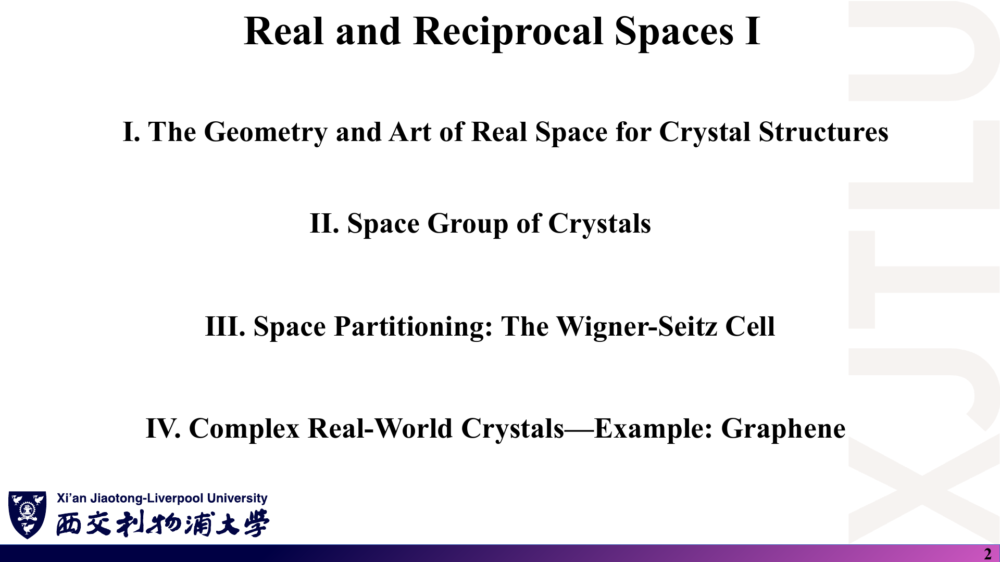
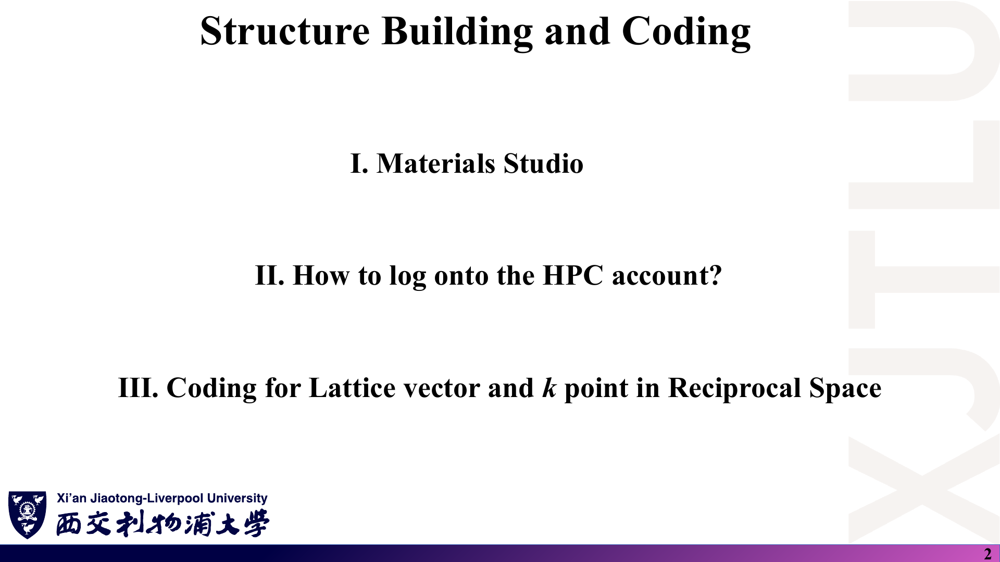

# MES306TC · 第二周图文学习笔记

课程：**Atomic-Level Materials Simulation（原子级材料模拟）** · 教师：Kenan Song

原始资料：4 份 PDF（Lecture Five–Eight），共 **105 页**；另有一组 Fortran 示例代码（`Codes/`）。以下 9 份 Markdown 均采用「课件截图 → 中文解释 → 原理深入 → Ref」结构。

> **截图是原讲义整页渲染，不是重新制作的幻灯片。** 原图中的笔误保留，正文单独解释正确写法。所有页码均为含封面的 PDF 物理页码。中文解释为整理，原理深入含补充推导，不能把二者都当作教师原话。

## 1. 怎样使用这套笔记？

### 课件截图



*第二周四讲的主线：实空间几何 → 倒空间与布里渊区 → 对称性与能带 → 建模与编程。图片宽 1920 像素，公式较小时可打开原 PNG 放大。*

### 中文解释

第一周给出了量子力学的数学语言；第二周把它放进**晶体**：先描述原子怎样周期排列，再把周期性翻译到倒空间（k 空间），然后用对称性解释能带的简并与带隙，最后动手在 Materials Studio / VESTA 中建结构、登录 HPC、用 Fortran 算倒格矢。

| 顺序 | 文件 | 内容 |
|---|---|---|
| 0 | 本页 README | 阅读方法、学习顺序、参考书目和学习记录 |
| 1 | [01_晶体几何与空间群.md](01_晶体几何与空间群.md) | Lecture Five：Bravais 格子与基元、原胞/惯用胞、空间群、Wyckoff 位置、Materials Project、Wigner–Seitz 胞、石墨烯双原子基元 |
| 2 | [02_倒空间与布里渊区.md](02_倒空间与布里渊区.md) | Lecture Six：倒格矢公式、BCC↔FCC、二维特例、第一布里渊区、高对称点、SeeK-path、不可约布里渊区 |
| 3 | [03_晶体对称性与能带.md](03_晶体对称性与能带.md) | Lecture Seven：对称操作矩阵、$[H,S]=0$、时间反演与 Kramers 简并、能带起源、带隙分类、有效质量、Bloch 定理、基组数与能带数、3N 规则 |
| 4 | [04_结构建模_HPC与倒格矢编程.md](04_结构建模_HPC与倒格矢编程.md) | Lecture Eight：Materials Studio 建胞、VESTA 导出 POSCAR、POSCAR 各行含义、MobaXterm 登录 HPC、Fortran 计算倒格矢 |
| 5 | [05_公式与术语速查.md](05_公式与术语速查.md) | 对照原图记公式、条件及英文术语 |
| 6 | [06_复习题与参考答案.md](06_复习题与参考答案.md) | 15 道自编题，每题配原图、题意、解析与来源 |
| 7 | [07_讲义勘误与易错点.md](07_讲义勘误与易错点.md) | 原图证据、正确写法与核验理由（含截图渲染缺字说明） |
| 8 | [08_代码导读.md](08_代码导读.md) | `LATTICECONVERSION.f90` 逐段解读、编译运行、预期输出与陷阱 |

### 原理深入

把四讲串成一条计算链，而不是孤立的名词：

```text
晶体结构 = Bravais 格子 + 基元（空间群 + Wyckoff 位置即可完整描述）
  ↓ 原胞矢量 a1, a2, a3（写进 POSCAR）
倒格矢 b_i = 2π (a_j × a_k) / [a1·(a2×a3)]       ← 第 8 讲的 Fortran 程序就做这一步
  ↓ 倒空间的 Wigner–Seitz 胞 = 第一布里渊区
高对称点与路径（SeeK-path），对称性约化到不可约区
  ↓ 每个 k 点求解 H(k)（Bloch 定理保证 k 是好量子数）
能带 E_n(k)：带隙、简并、有效质量、费米能级位置
```

例如，**“石墨烯 K 点的 Dirac 锥”** 同时用到了上面每一层：六角格子 + 双原子基元（第 5 讲）→ 六角形布里渊区的角点 K（第 6 讲）→ 对称性保护的线性交叉（第 7 讲）→ 实际计算时要先建胞、写 POSCAR、生成 k 路径（第 8 讲）。

阅读每个模块建议做四件事：

1. **看截图**：找到标题、公式、表格和图中标注。
2. **读中文解释**：回答“这页在解决什么问题？”
3. **读原理深入**：回答“为什么成立？如何推导？什么时候失效？”
4. **查 Ref**：回到指定 PDF 页；需要更系统理解时查延伸书目。

### Ref

- **原课件**：Kenan Song，[Lecture Five，PDF 第 2 页](../Lecture_Five.pdf#page=2)；[Lecture Six，PDF 第 2 页](../Lecture_Six.pdf#page=2)；[Lecture Seven，PDF 第 2 页](../Lecture_Seven.pdf#page=2)；[Lecture Eight，PDF 第 2 页](../Lecture_Eight.pdf#page=2)（四讲提纲）。
- **原始文件**：[Lecture Five](../Lecture_Five.pdf) · [Lecture Six](../Lecture_Six.pdf) · [Lecture Seven](../Lecture_Seven.pdf) · [Lecture Eight](../Lecture_Eight.pdf) · [Codes 目录](../Codes/)。原 PDF 与代码未修改。
- **来源记录**：[截图来源索引](课件截图/来源索引.json)，记录源 PDF 的 SHA-256、总页数及截图页码。

## 2. 学习顺序与完成标准

### 课件截图



### 中文解释

建议顺序：01 实空间 → 02 倒空间 → 03 对称性与能带 → 04 建模与编程 → 08 代码导读（亲手编译运行一次）→ 06 复习题 → 07 勘误复核。以下自学时间仅供安排：01 约 60 分钟，02 约 75 分钟，03 约 90 分钟，04 + 08 约 90 分钟（含上机），主动复习约 45 分钟。

### 原理深入

把“学会”定义成可以亲手完成，而不是觉得公式眼熟：

- [ ] 区分 Bravais 格子、基元与晶体结构；数出 BCC/FCC 惯用胞中的格点数。
- [ ] 解释为什么石墨烯是“六角 Bravais 格子 + 两原子基元”，而不是蜂窝 Bravais 格子。
- [ ] 用 Wyckoff 位置 2a 和体心平移生成 BCC Fe 惯用胞中的两个原子。
- [ ] 画出二维正方、六角格子的 Wigner–Seitz 胞。
- [ ] 由 $\mathbf a_i$ 手算 $\mathbf b_j$ 并验证 $\mathbf a_i\cdot\mathbf b_j=2\pi\delta_{ij}$。
- [ ] 证明 BCC 原胞的倒格子是 FCC，并用 SeeK-path 输出核对数值。
- [ ] 写出二维石墨烯的 $\mathbf b_1,\mathbf b_2$，求出 $\Gamma$、M、K 的坐标。
- [ ] 用迹的整数性证明晶体学限制定理（只允许 1、2、3、4、6 次旋转）。
- [ ] 从 $[H,S]=0$ 推出 $E_n(S\mathbf k)=E_n(\mathbf k)$；说明 P、T、PT 各自给出的能带关系。
- [ ] 由能带曲率求有效质量；判断 n 型/p 型半导体费米能级的位置。
- [ ] 由基组标记（如 `Ga7.0-s2p2d2`）数出每个原子的轨道数和总能带数。
- [ ] 解释 3N×3N 超胞为什么把 Dirac 点折叠到 $\Gamma$。
- [ ] 逐行说出 POSCAR 每一行的含义；在 HPC 上编译运行 `LATTICECONVERSION.f90` 并得到 2.1969180202。

| 日期 | 已完成模块 | 能否独立推导 | 疑问与下一步 |
|---|---|---|---|
|  |  |  |  |
|  |  |  |  |
|  |  |  |  |

### Ref

- **原课件**：[Lecture Eight，PDF 第 2 页](../Lecture_Eight.pdf#page=2)、[第 39–40 页](../Lecture_Eight.pdf#page=39)（编译、运行与输出）。
- **配套练习**：[15 道复习题](06_复习题与参考答案.md)。这些题目为学习整理自编，不是官方作业。

## 3. 如何核对公式与使用 Ref？

### 课件截图


*示例：此页 $\mathbf b_2$ 与 $\mathbf b_1$ 的分子都写成 $\mathbf a_2\times\hat{\mathbf n}$，两者会完全相同。截图忠实保留原文，不表示原式已经通过核验。*

### 中文解释

笔记的 Ref 区分三种来源：

- **原课件**：直接定位本知识点在本地 PDF 中的位置。
- **推导依据 / 配套笔记**：指向正确公式、例题或核验步骤。
- **延伸阅读**：推荐教材、论文或文档，帮助进一步学习；不是声称已逐页读完这些外部资料。

本周约定：倒格矢采用含 $2\pi$ 的物理学约定 $\mathbf a_i\cdot\mathbf b_j=2\pi\delta_{ij}$（与讲义、SeeK-path 一致；晶体学文献和部分软件输出不含 $2\pi$，需要换算）。分数坐标（POSCAR 的 `Direct`）是沿 $\mathbf a_1,\mathbf a_2,\mathbf a_3$ 的系数，不是沿笛卡尔 $x,y,z$ 轴的坐标。

### 原理深入

倒空间公式最有效的核验是**对偶关系**：任何一组候选 $\mathbf b_j$ 都必须满足

$$
\mathbf a_i\cdot\mathbf b_j=2\pi\delta_{ij}.
$$

以第 7 页为例：若 $\mathbf b_2\propto\mathbf a_2\times\hat{\mathbf n}$，则 $\mathbf a_2\cdot\mathbf b_2=0\neq2\pi$，立刻可判定有误；正确分子应为 $\hat{\mathbf n}\times\mathbf a_1$。

同样可以用以下方法发现错误：

- **算术与计数**：把讲义中的乘法与加法重算一遍（第 7 讲第 19 页即有两处计数错误）。
- **量纲**：倒格矢单位是长度的倒数（Å⁻¹），“$\mathbf b=1/\mathbf a$”这种写法对矢量没有定义。
- **极限与特例**：正交晶格时 $|\mathbf b_i|=2\pi/|\mathbf a_i|$；斜交时不成立。
- **与工具输出对照**：SeeK-path、VESTA 或自己编译的程序输出应与手算一致。

截图覆盖四份讲义除封面与结束页外的 **97 页**，保存在 `课件截图/Lecture_*/page-XX.png`；各笔记按主题选图，不要求重复展示每一页。个别符号或公式在原 PDF 中即已缺失（例如 Lecture Seven 第 21 页的“$\Gamma$”），已在 [07](07_讲义勘误与易错点.md) 中逐条说明，未在截图上修补。PDF 的 `#page=` 跳转是否生效取决于阅读器，但 Ref 中也写出了页码。

### Ref

- **原课件**：[Lecture Six，PDF 第 7 页](../Lecture_Six.pdf#page=7)。
- **核对记录**：[讲义勘误与易错点](07_讲义勘误与易错点.md)。它是学习记录，不是教师官方勘误。
- **外部资料使用说明**：下列教材为延伸书目，未逐章核读；未据此虚构页码。论文条目中的期刊、卷号与 DOI 以讲义截图中印出的信息为准或为广泛引用的标准文献；网站与软件文档只核对了名称与用途。

#### 延伸参考书目与文档索引

<a id="ref-ss1"></a>
**[SS1]** Neil W. Ashcroft & N. David Mermin, *Solid State Physics*, Holt, Rinehart and Winston, 1976。检索主题：Bravais 格子、原胞与 Wigner–Seitz 胞、倒格子、布里渊区、Bloch 定理、半经典动力学与有效质量。

<a id="ref-ss2"></a>
**[SS2]** Charles Kittel, *Introduction to Solid State Physics*, 8th ed., Wiley, 2005。检索主题：晶体结构、倒格子与衍射、布里渊区、能带与半导体载流子。

<a id="ref-ita"></a>
**[ITA]** International Union of Crystallography, *International Tables for Crystallography, Volume A: Space-Group Symmetry*。检索主题：230 个空间群、17 个平面群、Wyckoff 位置与位置对称性。可配合 [Bilbao Crystallographic Server](https://www.cryst.ehu.es/) 在线查询。

<a id="ref-gt"></a>
**[GT]** M. S. Dresselhaus, G. Dresselhaus & A. Jorio, *Group Theory: Application to the Physics of Condensed Matter*, Springer, 2008。检索主题：对称算符与哈密顿量对易、能带简并、时间反演与 Kramers 简并。

<a id="ref-sc10"></a>
**[SC10]** W. Setyawan & S. Curtarolo, “High-throughput electronic band structure calculations: Challenges and tools”, *Computational Materials Science* 49 (2010) 299–312, DOI: 10.1016/j.commatsci.2010.05.010。讲义第 6 讲第 13–16 页各布里渊区图与 k 路径的出处（图下方印有此 DOI）。

<a id="ref-hpkot"></a>
**[HPKOT]** Y. Hinuma, G. Pizzi, Y. Kumagai, F. Oba, I. Tanaka, “Band structure diagram paths based on crystallography”, *Computational Materials Science* 128 (2017) 140, DOI: 10.1016/j.commatsci.2016.10.015。SeeK-path 的方法论文（见讲义第 6 讲第 18、20 页截图）；工具网址 <https://seekpath.materialscloud.io/>。

<a id="ref-mp"></a>
**[MP]** [The Materials Project](https://next-gen.materialsproject.org/)；方法论文：A. Jain *et al.*, “Commentary: The Materials Project: A materials genome approach to accelerating materials innovation”, *APL Materials* 1 (2013) 011002。用于查询空间群、晶格常数、Wyckoff 位置并导出 CIF/POSCAR。

<a id="ref-vesta"></a>
**[VESTA]** K. Momma & F. Izumi, “VESTA 3 for three-dimensional visualization of crystal, volumetric and morphology data”, *Journal of Applied Crystallography* 44 (2011) 1272–1276。用于 CIF ↔ POSCAR 转换与结构可视化。

<a id="ref-poscar"></a>
**[POSCAR]** [VASP Wiki：POSCAR](https://www.vasp.at/wiki/index.php/POSCAR)。POSCAR 各行含义、缩放因子（含负值表示体积）与 `Direct`/`Cartesian` 约定的官方说明。

<a id="ref-gr09"></a>
**[GR09]** A. H. Castro Neto, F. Guinea, N. M. R. Peres, K. S. Novoselov & A. K. Geim, “The electronic properties of graphene”, *Reviews of Modern Physics* 81 (2009) 109。检索主题：蜂窝格子、两个子格、K/K′ 点 Dirac 锥、子格对称性破缺开隙。

<a id="ref-3n"></a>
**[3N]** Y. C. Zhou, H. L. Zhang & W. Q. Deng, “A 3N rule for the electronic properties of doped graphene”, *Nanotechnology* 24 (2013) 225705。讲义第 7 讲第 20–21 页图片出处（按讲义引用信息列出）。

<a id="ref-omx"></a>
**[OMX]** [OpenMX 3.9 用户手册](https://www.openmx-square.org/openmx_man3.9/)。用于理解 `Ga7.0-s2p2d2` 这类数值原子轨道基组标记（截断半径与各角动量的径向函数个数）。

<a id="ref-gfort"></a>
**[GFORT]** [GNU Fortran (gfortran) 官方文档](https://gcc.gnu.org/onlinedocs/gfortran/)。用于核对 `SELECTED_REAL_KIND`、`INDEX`、`ADJUSTL`、表控输入输出等语言细节。
